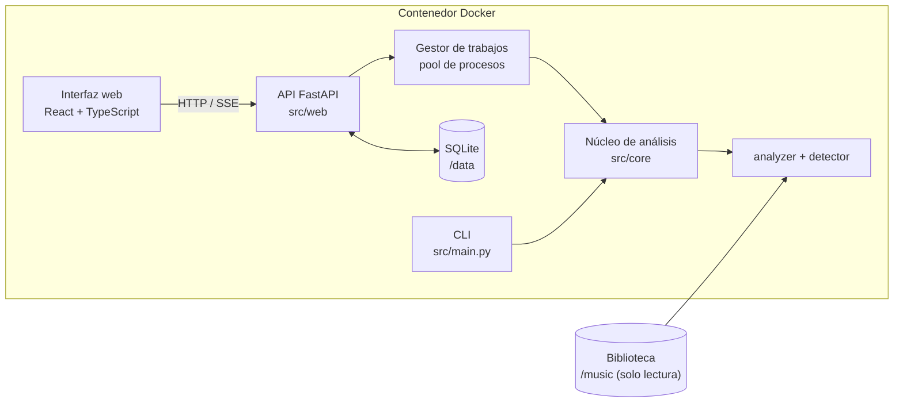

# 🎵 Fake Music Hunter

[](https://github.com/pedrit01/fake-music-hunter/releases)
[](https://github.com/pedrit01/fake-music-hunter/pkgs/container/fake-music-hunter)
[](https://www.python.org/downloads/)
[](tests/)
[](LICENSE)

Detecta archivos de audio falsos o "upscaleados" mediante análisis espectral: FLAC y WAV que en realidad vienen de un MP3, o MP3 etiquetados a 320 kbps que se codificaron a menos calidad.

Se usa desde el **navegador** (interfaz web en Docker), desde la **línea de comandos** o a través de una **API HTTP**. Las tres comparten el mismo motor de análisis, así que clasifican exactamente igual.

**📖 Documentación**: [Algoritmo](ALGORITHM.md) · [Validación con Spek](TESTING.md) · [Changelog](CHANGELOG.md) · [Contribuir](CONTRIBUTING.md) · [Publicar una versión](BUILD_RELEASE.md)

## 📑 Contenido

- [Qué detecta](#-qué-detecta)
- [Inicio rápido](#-inicio-rápido)
- [Interfaz web](#-interfaz-web)
- [Docker](#-docker)
- [Línea de comandos (CLI)](#-línea-de-comandos-cli)
- [API HTTP](#-api-http)
- [Arquitectura](#-arquitectura)
- [Cómo funciona el análisis](#-cómo-funciona-el-análisis)
- [Desarrollo](#-desarrollo)
- [Licencia](#-licencia)

## 🔍 Qué detecta

| Clasificación | Significado |
|---------------|-------------|
| ✅ **Legítimo** | El espectro corresponde al formato y bitrate declarados |
| ❌ **Fake** | Conversión desde un formato de menor calidad (por ejemplo, un FLAC hecho a partir de un MP3 de 128 kbps) |
| ⚠️ **Sospechoso** | Indicios de conversión que conviene revisar a mano, por ejemplo con [Spek](https://www.spek.cc/) |
| 🚫 **Error** | El archivo no se pudo leer o analizar |

- **FLAC y WAV**: busca contenido real por encima de 20 kHz y mide la presencia espectral entre 18 y 22 kHz. Un archivo convertido desde MP3 pierde esa banda.
- **MP3**: compara la frecuencia de corte con la que corresponde al bitrate declarado (128, 192, 256 o 320 kbps).
- **No modifica nada**: solo lee los archivos. En Docker, la música se monta en solo lectura.

## 🚀 Inicio rápido

Solo necesitas [Docker](https://docs.docker.com/get-docker/). La imagen está publicada en GitHub Container Registry para `linux/amd64` y `linux/arm64` (PC, servidores, Mac con Apple Silicon, Raspberry Pi 4/5):

```bash
docker run -d --name fake-music-hunter -p 127.0.0.1:8000:8000 \
  -v "/ruta/a/tu/musica":/music:ro \
  -v fmh-data:/data \
  ghcr.io/pedrit01/fake-music-hunter:2.1.0
```

Abre **http://localhost:8000**, elige una carpeta de tu biblioteca y pulsa "Analizar".

Otras formas de usarlo:

| Forma | Para quién | Dónde |
|-------|-----------|-------|
| **Interfaz web en Docker** | Uso normal, cualquier sistema | [Docker](#-docker) |
| **CLI dentro de Docker** | Scripts y reportes CSV/JSON sin instalar Python | [Modo CLI](#modo-cli-en-docker) |
| **Ejecutable de Windows** | CLI en Windows sin Python ni Docker | [Releases](https://github.com/pedrit01/fake-music-hunter/releases) |
| **Código fuente** | Desarrollo | [Desarrollo](#-desarrollo) |

## 🌐 Interfaz web

- **Analizar la biblioteca**: navega por las carpetas de la música montada, mira cuántos archivos hay de cada formato y lanza el análisis de una carpeta, con o sin subcarpetas y eligiendo los formatos.
- **Subir archivos sueltos**: arrastra y suelta MP3, FLAC o WAV. Se validan el formato y el tamaño antes de subirlos y se borran al terminar el análisis.
- **Progreso en vivo**: el contador y la barra avanzan solos, y el título de la pestaña muestra el porcentaje (`45 % · Analizando…`), así que puedes seguirlo desde otra pestaña. Se puede cancelar y lo ya analizado se conserva.
- **Problemas primero**: los resultados salen ordenados por gravedad (Fake → Sospechoso → Error → Legítimo). Puedes filtrar por "Solo problemas", clasificación o formato, buscar por nombre y ordenar por cualquier columna. La ordenación se aplica a todos los resultados, no solo a la página visible.
- **Detalle de cada archivo**: motivo de la clasificación y todas las métricas (bitrate, frecuencia de corte, presencia espectral, energía en altas frecuencias, rango dinámico…).
- **Reportes CSV y JSON**, con el mismo formato que la CLI.
- **Historial** de análisis, que se conserva entre reinicios.
- **Accesible y adaptada**: modo claro y oscuro, móvil, uso con teclado, lector de pantalla y "reducir movimiento".

## 🐳 Docker

La imagen incluye la interfaz web, la API y la CLI. No hace falta instalar Python, ffmpeg ni Node.

> ⚠️ **La aplicación no tiene autenticación.** Los ejemplos publican el puerto solo en `127.0.0.1` (tu equipo). No lo expongas a tu red o a Internet sin un proxy inverso con autenticación.

### Imagen publicada

```bash
docker pull ghcr.io/pedrit01/fake-music-hunter:2.1.0

docker run -d --name fake-music-hunter -p 127.0.0.1:8000:8000 \
  -v "/ruta/a/tu/musica":/music:ro \
  -v fmh-data:/data \
  ghcr.io/pedrit01/fake-music-hunter:2.1.0
```

Hay una etiqueta por versión (`2.1.0`) y `latest`. Para actualizar, descarga la etiqueta nueva, borra el contenedor (`docker rm -f fake-music-hunter`) y vuelve a crearlo: el historial sigue en el volumen `fmh-data`.

### Con Docker Compose

`docker-compose.yml` es un despliegue de ejemplo que construye la imagen desde el código. Clona el repositorio, opcionalmente en una versión concreta (las etiquetas están en [Releases](https://github.com/pedrit01/fake-music-hunter/releases)):

```bash
git clone https://github.com/pedrit01/fake-music-hunter.git
cd fake-music-hunter
git checkout Version-2.1.0   # opcional: fija la versión

MUSIC_DIR="/ruta/a/tu/musica" docker compose up -d
```

La primera vez construye la imagen, lo que tarda unos minutos. El historial se guarda en `./data`. Para pararlo, `docker compose down`. Para actualizar:

```bash
git pull
MUSIC_DIR="/ruta/a/tu/musica" docker compose up -d --build
```

Sin Git, descarga el ZIP del código fuente desde la página de la release.

### Construir la imagen

Desde la carpeta del repositorio:

```bash
docker build -t fake-music-hunter .
docker buildx build --platform linux/amd64,linux/arm64 -t fake-music-hunter .   # las dos arquitecturas
```

### Modo CLI en Docker

El mismo contenedor ejecuta la CLI con `cli` seguido de sus [opciones](#opciones). Monta una carpeta escribible en `/data` para guardar los reportes:

```bash
docker run --rm -v "/ruta/a/tu/musica":/music:ro -v "$PWD/output":/data \
  ghcr.io/pedrit01/fake-music-hunter:2.1.0 cli -p /music -o /data/reporte.csv -j /data/reporte.json
```

### Volúmenes

| Ruta en el contenedor | Uso |
|-----------------------|-----|
| `/music` | Tu biblioteca de música. Móntala siempre en solo lectura (`:ro`); la aplicación nunca escribe en ella |
| `/data` | Base de datos con el historial, subidas temporales y, en modo CLI, los reportes. Se puede borrar sin problema: solo contiene resultados que se pueden regenerar |

### Configuración

Se pasa con `-e VARIABLE=valor` en `docker run` o en la sección `environment` de `docker-compose.yml`.

| Variable | Por defecto | Descripción |
|----------|-------------|-------------|
| `FMH_LIBRARY_ROOT` | `/music` | Carpeta de música que se puede navegar y analizar (solo lectura) |
| `FMH_DATA_DIR` | `/data` | Carpeta escribible: base de datos de trabajos y subidas temporales |
| `FMH_PORT` | `8000` | Puerto del servicio dentro del contenedor |
| `FMH_WORKERS` | `min(2, CPUs)` | Archivos que se analizan a la vez |
| `FMH_MAX_UPLOAD_MB` | `500` | Tamaño máximo de cada archivo subido |
| `FMH_RETENTION_DAYS` | `30` | Días que se conservan los análisis terminados |

### Permisos (UID/GID)

El contenedor no se ejecuta como root, sino con el usuario `app` (UID 1000). Necesita **leer** `/music` y **escribir** en `/data`:

- Con Docker Desktop u OrbStack en macOS, los permisos se traducen solos.
- Con un volumen con nombre (como `fmh-data`), Docker lo crea con los permisos correctos.
- En Linux, con una carpeta del host como `./data`, si tu usuario no es el 1000 ejecuta el contenedor con tu UID/GID: `--user "$(id -u):$(id -g)"` en `docker run`, o descomenta `user:` en `docker-compose.yml`. Crea antes la carpeta (`mkdir data`) para que sea tuya y no de root.

### Memoria

Cada archivo que se analiza a la vez ocupa un proceso de unos 200-300 MB de RAM. Sube `FMH_WORKERS` si tienes RAM y núcleos de sobra (por ejemplo, `4` con 2 GB libres) o bájalo a `1` en máquinas pequeñas como una Raspberry Pi.

## 💻 Línea de comandos (CLI)

La CLI analiza una carpeta, muestra el resultado en la consola y, si se pide, guarda reportes CSV y JSON. Se puede ejecutar de tres formas:

```bash
# Con Docker (ver "Modo CLI en Docker")
docker run --rm -v "/ruta/a/tu/musica":/music:ro ghcr.io/pedrit01/fake-music-hunter:2.1.0 cli -p /music

# Con el ejecutable de Windows (descárgalo de Releases)
.\fake-music-hunter.exe -p "C:\Music"

# Desde el código fuente (ver Desarrollo)
python -m src.main -p "/ruta/a/tu/musica"
```

### Opciones

| Opción | Descripción | Ejemplo |
|--------|-------------|---------|
| `-p, --path` | Carpeta a analizar (obligatoria) | `-p "C:\Music"` |
| `--recursive / --no-recursive` | Incluir subcarpetas (por defecto, sí) | `--no-recursive` |
| `-f, --formats` | Formatos a analizar; se puede repetir. Por defecto, todos | `-f flac -f mp3` |
| `-o, --output` | Guardar el reporte CSV | `-o reporte.csv` |
| `-j, --json` | Guardar el reporte JSON | `-j reporte.json` |
| `-v, --verbose` | Mostrar el detalle de todos los archivos, no solo los problemas | `-v` |
| `--version` | Mostrar la versión | |
| `--help` | Mostrar la ayuda | |

### Ejemplo de salida

```
Fake Music Hunter v2.1.0
══════════════════════════════════════════════════

📁 Escaneando: C:\Music\Albums
   Archivos encontrados: 77

[X] FAKE: Oxygene (Hard Rave Version).flac
   • Bitrate: 998 kbps
   • Frecuencia de corte: 16000.0 Hz
   • Presencia espectral (18-22kHz): 0.0%
   • Sin contenido espectral en altas frecuencias - conversión desde MP3 de baja calidad

[!] SUSPICIOUS: Flying Free.flac
   • Presencia espectral 17.7% moderada - posible conversión de alta calidad

══════════════════════════════════════════════════

RESUMEN:
   Total analizado: 77
   [OK] Legitimos: 66 (85.7%)
   [X] Fake: 2 (2.6%)
   [!] Sospechosos: 8 (10.4%)
   [ERR] Errores: 1 (1.3%)
```

Los marcadores `[OK]`, `[X]`, `[!]` y `[ERR]` son ASCII a propósito, para que se vean bien en la consola de Windows.

## 🔌 API HTTP

El servicio web expone una API REST (FastAPI) para lanzar análisis desde otras herramientas. Los análisis se ejecutan en segundo plano y el progreso se puede seguir en tiempo real. La documentación interactiva (OpenAPI) está en `http://localhost:8000/docs`.

| Método | Ruta | Descripción |
|--------|------|-------------|
| GET | `/api/health` | Estado del servicio, versión y si hay biblioteca montada |
| GET | `/api/library?path=<carpeta>` | Subcarpetas y número de archivos de audio de una carpeta de la biblioteca |
| POST | `/api/jobs` | Analiza una carpeta: `{"path": "Albums/2024", "recursive": true, "formats": ["flac"]}` |
| POST | `/api/jobs/upload` | Analiza archivos subidos (`multipart/form-data`, campo `files`) |
| GET | `/api/jobs` | Historial de análisis (`offset`, `limit`) |
| GET | `/api/jobs/{id}` | Estado y progreso: `queued`, `running`, `completed`, `failed` o `cancelled` |
| GET | `/api/jobs/{id}/results` | Resultados paginados (`offset`, `limit`), filtrables por `classification` (uno o varios valores), `format` y `q` (nombre), y ordenables con `sort` y `order` |
| GET | `/api/jobs/{id}/events` | Progreso en tiempo real (Server-Sent Events: `progress` y `done`) |
| GET | `/api/jobs/{id}/report.csv` · `report.json` | Descarga del reporte (mismo formato que la CLI) |
| POST | `/api/jobs/{id}/cancel` | Cancela un análisis en curso; los resultados ya obtenidos se conservan |

**Filtrar y ordenar resultados.** `classification` se puede repetir para pedir varias clasificaciones a la vez. `sort` ordena todos los resultados en el servidor, antes de paginar:

- Valores de `sort`: `severity` (fake → suspicious → error → legitimate), `file_name`, `format`, `bitrate`, `cutoff_frequency` o `spectral_presence`.
- `order` puede ser `asc` (por defecto) o `desc`. Los valores ausentes quedan siempre al final.
- Sin `sort`, los resultados salen en el orden en que se analizaron.
- Un valor no admitido devuelve un error 422 que indica los valores válidos.

```bash
# Solo los problemas, los más graves primero
curl "http://localhost:8000/api/jobs/<id>/results?classification=fake&classification=suspicious&classification=error&sort=severity"

# Frecuencias de corte más bajas primero
curl "http://localhost:8000/api/jobs/<id>/results?sort=cutoff_frequency&order=asc&limit=20"
```

Las rutas de la biblioteca son siempre relativas a su raíz; cualquier ruta que intente salir de ella (`..`, rutas absolutas o enlaces simbólicos) se rechaza.

## 🏗️ Arquitectura



- **Núcleo compartido (`src/core`)**: `analyze_file` analiza un archivo y devuelve un `AnalysisResult`; nunca lanza excepciones, los fallos se convierten en resultados `error`. La CLI y la web lo usan igual, por eso coinciden siempre. Los exportadores CSV/JSON también son comunes.
- **Análisis (`analyzer.py`, `detector.py`)**: carga los primeros 30 segundos con librosa, calcula el espectro (STFT) y aplica las reglas de cada formato.
- **API (`src/web`)**: cada análisis es una tarea en segundo plano que reparte los archivos entre un pool de procesos, con como mucho `FMH_WORKERS` a la vez. Guarda cada resultado en SQLite según llega y publica el progreso por Server-Sent Events. Al arrancar, los análisis que quedaron a medias se marcan como fallidos, y una limpieza periódica borra subidas huérfanas y análisis antiguos.
- **Interfaz (`frontend/`)**: aplicación de una sola página que sirve la propia API; no hay otro servidor. Sigue el progreso por SSE y, si la conexión falla, consulta cada 2 segundos.
- **CLI (`src/main.py`)**: no importa nada de la parte web, así que el ejecutable de Windows no incluye FastAPI.

## 🔬 Cómo funciona el análisis

### FLAC y WAV: algoritmo híbrido

```
¿Hay contenido por encima de 20 kHz?
  ├─ SÍ → ✅ LEGÍTIMO (un MP3 nunca conserva esa banda)
  └─ NO → presencia espectral en 18-22 kHz (% de la banda con energía)
            > 30 %  → ✅ LEGÍTIMO
           15-30 %  → ✅ LEGÍTIMO si la energía es suficiente; si no, ⚠️ SOSPECHOSO
            5-15 %  → ⚠️ SOSPECHOSO
             < 5 %  → ❌ FAKE si el corte está por debajo de 16,5 kHz; si no, ⚠️ SOSPECHOSO
```

### MP3

Cada bitrate tiene un corte esperado (320 kbps → ~20 kHz, 256 → 19,5 kHz, 192 → 18 kHz, 128 → 16 kHz). Si la frecuencia de corte real está claramente por debajo de la que corresponde al bitrate declarado, el archivo se codificó a menos calidad y después se volvió a codificar.

### Métricas

| Métrica | Qué mide |
|---------|----------|
| Contenido por encima de 20 kHz | Detección rápida y definitiva de lossless auténtico |
| Presencia espectral (18-22 kHz) | Porcentaje de la banda alta con energía real; más fiable que el corte por sí solo |
| Frecuencia de corte | Dónde cae la energía del espectro |
| Energía en altas frecuencias | Confirma la presencia espectral |
| Rango dinámico | Diferencia entre partes suaves y fuertes (dB) |

En pruebas con 77 FLAC reales, el algoritmo híbrido de la v2.0 redujo los falsos positivos y los errores respecto a la v1.0: ver [CHANGELOG](CHANGELOG.md). Para la explicación completa, con diagramas y pseudocódigo, ver [ALGORITHM.md](ALGORITHM.md). Para comprobar un resultado a mano con un espectrograma, ver [TESTING.md](TESTING.md).

## 🛠️ Desarrollo

Todo se puede desarrollar y probar con Docker, sin instalar Python ni Node en tu equipo.

```bash
git clone https://github.com/pedrit01/fake-music-hunter.git
cd fake-music-hunter

# Imagen de desarrollo con las dependencias (el código se monta en /app)
docker build -f docker/dev.Dockerfile -t fmh-dev .

# Tests
docker run --rm -v "$PWD":/app fmh-dev pytest
docker run --rm -v "$PWD":/app fmh-dev pytest --cov=src --cov-report=term-missing

# CLI desde el código
docker run --rm -v "$PWD":/app -v "/ruta/a/tu/musica":/music:ro fmh-dev python -m src.main -p /music -v

# API desde el código (http://localhost:8000/docs)
docker run --rm -p 127.0.0.1:8000:8000 -v "$PWD":/app -v "/ruta/a/tu/musica":/music:ro \
  -e FMH_DATA_DIR=/tmp/fmh-data fmh-dev uvicorn src.web.app:create_app --factory --host 0.0.0.0 --port 8000

# Compilar la interfaz (node_modules vive en un volumen de Docker)
docker run --rm -v "$PWD/frontend":/app -v fmh-node-modules:/app/node_modules -w /app node:22-alpine npm install
docker run --rm -v "$PWD/frontend":/app -v fmh-node-modules:/app/node_modules -w /app node:22-alpine npm run build
```

Para desarrollar la interfaz con recarga en caliente, ver [frontend/README.md](frontend/README.md).

Sin Docker, con Python 3.13 y un entorno virtual: `pip install -r requirements-dev.txt` y después `pytest` o `python -m src.main -p <carpeta>`. Las dependencias van por capas: `requirements.txt` (CLI) ← `requirements-web.txt` (API) ← `requirements-dev.txt` (tests).

### Estructura del proyecto

```
fake-music-hunter/
├── src/
│   ├── main.py          # CLI
│   ├── core/            # Núcleo compartido: análisis de un archivo, resultado y reportes CSV/JSON
│   ├── web/             # API FastAPI: trabajos, SQLite, rutas seguras, subidas, limpieza
│   ├── analyzer.py      # Análisis espectral (STFT, presencia espectral, corte)
│   ├── detector.py      # Reglas de clasificación por formato
│   ├── scanner.py       # Búsqueda de archivos de audio
│   ├── reporter.py      # Salida por consola
│   └── config.py        # Umbrales y constantes
├── frontend/            # Interfaz web (React + TypeScript + Vite)
├── tests/               # pytest; tests/web cubre la API
├── docker/              # Entrypoint e imagen de desarrollo
├── openspec/            # Especificaciones y cambios planificados (OpenSpec)
├── Dockerfile           # Imagen de producción (web + API + CLI)
└── docker-compose.yml   # Despliegue de ejemplo
```

### Ejecutable de Windows

El `.exe` de cada versión está en [Releases](https://github.com/pedrit01/fake-music-hunter/releases). Para compilarlo tú, en Windows y con el Python del entorno virtual:

```powershell
python -m PyInstaller --onefile --name fake-music-hunter src\main.py --noconfirm
```

[BUILD_RELEASE.md](BUILD_RELEASE.md) tiene la guía completa y los pasos para publicar una versión (etiqueta, imagen en GHCR y release).

### Contribuir

Las contribuciones son bienvenidas: abre un issue o un pull request. Ver [CONTRIBUTING.md](CONTRIBUTING.md). Si un archivo se clasifica mal, incluye en el issue la salida del programa y, si puedes, su espectrograma en Spek.

## 📄 Licencia

[MIT](LICENSE) © pedrit01

Gracias a [librosa](https://librosa.org/) por el análisis de audio y a [Spek](https://www.spek.cc/) por la validación visual.
